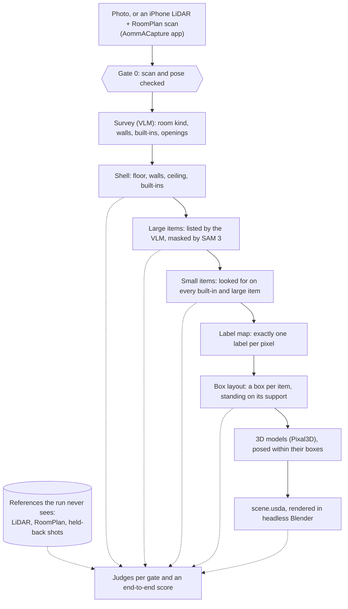

# AommA

AommA turns a single photo of a room into a 3D USD scene: it finds the room's shell and every object in it, builds
each one, and lays them out so that rendering the scene through the estimated camera reproduces the photo.

It is an agent harness rather than one model. It coordinates a vision-language model, segmentation, depth and
image-to-3D models on GPU servers, and headless Blender. Each step is judged by measurement against data the run
never saw, never by asking a model whether the result looks right.

## Results

- **Fitting the depth to the phone's LiDAR cut furniture placement error by a third,** median 0.23 m to 0.15 m,
  measured against Apple RoomPlan's scan of the room (16 shots of three rooms, the same models and items in both
  conditions). The camera's height came within 3 cm of ARKit's on 15 of 16 shots, up from 8.
- **The room's shell from RoomPlan, snapped to each shot's own LiDAR,** beat the photo-only shell in 95 of 96
  comparisons, on two independent draws.
- **A bookshelf's fit to its photo went from 0.40 to 0.79** once the cause was measured first: the books cut holes in
  its outline that capped even a perfect model at about 0.52. Furniture that holds things now treats such holes as
  its contents: the fit ignores them, and an image editor fills them before the model is generated. Five ways of
  handling the holes were compared on the same photo.
- **Generating at a lower resolution made image-to-3D 1.5 to 5 times faster** with no loss of fit; repeated seeds
  showed which apparent differences were noise.
- **The automatic review loop rarely pays for itself:** of 12 fixes it made, 2 improved the fit, both on objects
  fitting below 0.6; none of the five on objects at 0.87 or better helped. So it is not part of the layout-first
  pipeline (see Engineering).
- **Some ideas were measured and dropped:** 3D models for small
  items (no measurable gain over boxes and photo-textured sheets, at most of the GPU time), RoomPlan's object boxes as
  placement priors, a partition-first segmentation, and Depth Pro 2 in place of MoGe. Each missed a bar agreed
  before it ran.

## How it works



**Layout first.** Image-to-3D is the costliest step (a median of almost 8 minutes a model), so nothing is generated
until the layout has been judged as plain boxes. Every pixel of the photo gets exactly one label (floor, a wall, a
built-in, an item, or a counted `unknown`), and the stages are checked at gates:

| Gate | Judges | Reference |
| --- | --- | --- |
| 0 | each shot's camera pose | the scan's other shots' LiDAR |
| 1 | the shell's pixels | RoomPlan's room, snapped to the shot's LiDAR |
| 2 | large items' pixels: listed, complete, not leaking | RoomPlan's object boxes, the pixels the LiDAR puts in front of the shell |
| 3 | small items, and how much of the photo is `unknown` | items found in held-back reference shots |
| 4 | the layout as boxes: centre, size, heading, support | the same reference items, in 3D |
| 5 | the 3D models | the item's own passed box, and the reference |

**Decisions come from the scene, not from rules.** No constants are tuned to the test rooms, and no step decides
by an object's kind. A VLM's kind label varies from one run to the next, so for example every built-in and large
item is searched for small items, not only those called a counter or a desk.

## How results are judged

- **Inputs and references are kept apart.** A capture's input shots go to the run. Its reference shots, keyframes,
  LiDAR and RoomPlan room are used only to judge it, rendered at camera views the run was never given.
- **The scan is checked first** (`aomma scan-check`): each shot's LiDAR against the scan's mesh, and the LiDAR's
  scale against a printed calibration board of known size.
- **Bars before fixes.** Each gate's bar is agreed after its baseline and before any fix, so the fixes don't set
  their own bar. A change to how a gate measures is held to the same rule (`aomma measure-change`): it is judged on
  the baseline before and after, so a looser measure can't pass for progress.
- **A noise floor.** A second build of the same commit, with the VLM's sampling moved, shows how much a result
  varies by chance. A gain smaller than that isn't read as real.
- **Held-out rooms.** Some scanned rooms are never looked at during development and are run only to confirm a
  committed change.
- **An end-to-end score on every round** (`aomma score`): the whole scene, rendered at the reference views, against
  the LiDAR, so a gain at one gate that costs the scene shows up.

## Engineering

- **State passes through typed files, not a conversation.** Each VLM call is stateless (one image, one narrow
  question) and must answer to a JSON schema; the reply is checked against a typed model before anything acts on it.
  Every stage writes its result to the run folder (`survey.json`, `labels.png`, `layout.json`, `scene.usda`), so any
  stage can be resumed, rerun or inspected on its own.
- **One job queue for every process** (`jobqueue.py`): a file guarded by a lock, with two lanes, so a quick VLM, mask
  or depth job never waits hours behind another run's 3D models.
- **Rounds** (`aomma round <plan>.toml`): a night's commands run in order from a checked plan, each step on the runs
  an earlier one made. A round refuses uncommitted code, runs from a checkout of its commit, and is shown step by
  step on the dashboard.
- **Provenance:** every file records what made it and from which inputs; every command records the commit and a hash
  of any uncommitted patch; every queued job records how long it waited and ran; every VLM call records its tokens.
- **Recovery:** runs resume where they stopped; unreachable servers are retried; a failed mask job is retried one
  object at a time; a mask that misses its box is tried again from the object's name, then its description; a quick
  job may run for an hour and a 3D model for three before it is stopped; billed tokens are capped per run.
- **A review loop** (`agent.py`): a VLM critic and geometric checks (behind a wall, colliding, off its support, the
  wrong size) each name what is wrong with an object. A fixed table gives the actions worth trying for each
  complaint, best first; each fix is measured again and undone if the outline fits worse, and every step is logged to
  `agent.jsonl`. Measured, it rarely paid (see Results), so it runs only at the end of `aomma run`, the original
  single-pass pipeline, and not in the layout-first one (`aomma staged`).
- **A companion iOS app,** AommACapture, sends photos (`POST /runs`) and whole LiDAR and RoomPlan scans
  (`POST /scans`) to the dashboard, and a scan API serves runs and results back to the capture and headset apps.

## Quick start

```sh
uv sync
uv run aomma demo                        # writes runs/<timestamp>-demo/{scene.usda,render.png}
uv run aomma staged images/photo.jpg     # the layout-first build: masks, labels and box layout, no models
uv run aomma run images/photo.jpg        # the original single-pass pipeline, models and review included
uv run aomma dashboard                   # runs, jobs and rounds at http://localhost:8765
uv run pytest
```

`run` needs the model servers named in `config/default.yaml`: an Ollama vision model, and ComfyUI with the SAM 3,
MoGe and image-to-3D workflows in `workflows/`. They default to this machine. Put other addresses in
`config/local.yaml` (not in git), which is laid over the defaults key by key:

```yaml
vlms:
  local:
    url: http://gpu-box:11434
comfy:
  light: [http://gpu-box:8189]
  heavy: [http://gpu-box:8188]
```

Rendering uses headless Blender. Set `AOMMA_BLENDER` if it is not at
`/Applications/Blender.app/Contents/MacOS/Blender`.

## Running in the background

```sh
uv run aomma run images/photo.jpg       # returns at once; prints the run folder
tail -f runs/<run>/run.log              # follow it (the dashboard's run page shows the same log)
uv run aomma run runs/<run>             # pick a stopped run up where it left off
uv run aomma stop runs/<run>            # end it and take its jobs off the servers
```

A capture is imported with `aomma import-capture scans/<scan>`, and judged with `aomma scan-check`, the gate judges
(`aomma judge-shell`, `judge-large`, `judge-small`, `judge-boxes`, `judge-models`) and `aomma score`. `aomma --help`
lists every command.

Restart the dashboard after updating the code: a running server keeps the old code until it is stopped and started
again (`aomma stop dashboard`).

## Experiments

```sh
uv run aomma experiment runs/<run> "Can the desk be generated faster without looking worse?" --trials 3
```

The local VLM is given the question, plans trials, runs them and reports. It can call only three tools: `run_trial`
(generate one object again in a copy of the run, with another image-to-3D workflow, some settings lowered, or both),
`pose_trial` (pose an object's existing model again with other settings) and `finish`. Every trial reports the
model's fit to the photo, the share of it a wall hides and its height off the floor. The report puts the harness's
own table of what each trial measured beside the model's findings, so the two can be checked against each other.

## Conventions

- Z-up, metres, right-handed (Blender's native frame).
- One USD file per asset: default prim `/Asset`, pivot at bottom-centre.
- `scene.usda` only references assets and holds their poses, the camera and lights.
- `layout.json` (`aomma.layout.SceneLayout`) is the source of truth for poses.

## Code layout

- `src/aomma/cli.py`: the `aomma` command
- `src/aomma/stages/`: the pipeline's stages (survey, shell, large and small items, labels, boxes, pose)
- `src/aomma/judge*.py`, `ref*.py`: the gate judges and the references they read
- `src/aomma/backends/`: model servers (VLMs, ComfyUI)
- `src/aomma/usd/`, `src/aomma/render/`: USD assets and scenes, the Blender renderer
- `src/aomma/dashboard.py`: the web dashboard and the capture apps' API
- `workflows/`: the ComfyUI workflows
- `docs/`: the project site
